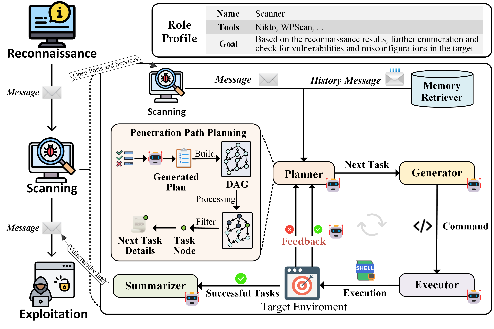

# PenAgent: Autonomous Penetration Testing for a Multi-Agent Collaborative Framework

<p align="center">
  <a href=''></a> 
  <a href='https://arxiv.org/abs/2501.13411'>.svg'></a> 
</p>

## Table of Contents

- [Overview](#overview)
- [Quick Start](#quick-start)
- [Citation](#citation)
- [Contact](#contact)

---

## Overview

**Note:**
- ⭐ **If you find this project useful, please consider giving it a <font color='orange'>STAR</font>!** ⭐
- If you encounter any <font color='red'>errors</font> or <font color='red'>issues</font>, feel free to open an issue or submit a pull request.

PenAgent is an advanced automated penetration testing framework that utilizes Large Language Models (LLMs) to replicate the workflow of human penetration testing teams within a multi-agent system. This innovative approach enhances efficiency, collaboration, and adaptability in security assessments.



*This RAG implementation is based on [Langchain-Chatchat](https://github.com/chatchat-space/Langchain-Chatchat). Special thanks to the authors.*

---

## Quick Start

### Prerequisites

Ensure your environment meets the following requirements before proceeding:

- **Programming Language:** Python 3.11 / 3.12
- **Package Manager:** Pip

### Installation

Install PenAgent using one of the following methods:

#### Build from Source

1. Clone the repository:

   ```sh
   git clone https://github.com/KHenryAegis/VulnBot.git PenAgent
   ```

2. Navigate to the project directory:

   ```sh
   cd PenAgent
   ```

3. Install the dependencies:

   ```sh
   pip install -r requirements.txt
   ```

### Configuration Guide

Before initializing PenAgent, you need to configure system settings. Refer to the [Configuration Guide](Configuration%20Guide.md) for detailed instructions on modifying:

- **Kali Linux configuration** (hostname, port, username, password)
- **MySQL database settings** (host, port, user, password, database)
- **LLM settings** (base_url, llm_model_name, api_key)
- **Enabling RAG** (set `enable_rag` to `true` and configure `milvus` and `kb_name`)

### Initialize the Project

Before using PenAgent, initialize the project:

```sh
python cli.py init
```

### Start the RAG Module

```sh
python cli.py start -a
```

### Run PenAgent

To execute PenAgent, use:

```sh
python cli.py penagent -m {max_interactions}
```

Replace `{max_interactions}` with the desired number of interactions. (For compatibility, `python cli.py vulnbot` is also supported).

### Layered Agent

A second orchestration engine built on LangGraph 1.x: LLM-written task plans
(DAG), a ReAct loop per task, one LLM judge per task, failures handed back to the
planner verbatim, layered budgets, command-level approval, context budgets,
per-node token accounting, checkpointed resume and forking.

```sh
python cli.py agent -t 100.84.151.2                 # full run
python cli.py agent -t 100.84.151.2 --dry-run       # no API calls, no SSH
python cli.py agent -t 100.84.151.2 --hitl          # approve intrusive commands
python cli.py agent -t 100.84.151.2 --thread-id my-run --resume

# inspect a run, then re-run only its tail
python cli.py agent --history --thread-id my-run
python cli.py agent -t 100.84.151.2 --thread-id my-run --from-checkpoint a52277

# switch lab (Kali + target), see agents.md for the IP table
run_lab1.cmd
run_lab2.cmd
```

Design notes worth knowing before reading the code:

- **The model judges, code only observes.** Every finished task costs one
  evaluator call, fed with tool output and commands but never with the
  assistant's own claims. A scan that completes with a negative result is a valid
  answer, which no keyword list got right.
- **Failures are described, not classified.** The replan prompt carries the
  failed task, its last command, the evaluator's reason and the decisive output;
  the planner picks the next angle.
- **Deterministic code is reserved for facts.** Fact extraction, exit codes and
  the destructive-command kill switch. `compromised` comes only from
  `uid=0`/flag evidence in the output, so no report can claim root without it.
- **The loop has brakes.** Unknown tool names are not charged to the budget, and
  repeated identical observations with no new facts end the task.
- **Context and cost are bounded** by explicit budgets; every model call is
  attributed to the node that made it.

See [docs/AGENT.md](docs/AGENT.md) for the architecture, state model, verdict
rules, configuration reference and extension points. Run the suite with
`python -m unittest discover -s tests -t .` (96 tests, no API key or SSH needed).
The original `penagent` command and benchmark are unchanged.

### Benchmark & Evaluation

PenAgent includes built-in benchmarking harnesses to evaluate and compare performance against baseline approaches:

- **Evaluate against Single-Agent Baseline**:
  ```sh
  python cli.py benchmark baseline
  ```
- **Evaluate against PentestGPT**:
  ```sh
  python cli.py benchmark pentestgpt
  ```

---

## Citation

If you use PenAgent or its foundational research for academic purposes, please cite our [paper](https://arxiv.org/abs/2501.13411):

```bibtex
@misc{kong2025vulnbotautonomouspenetrationtesting,
      title={VulnBot: Autonomous Penetration Testing for a Multi-Agent Collaborative Framework}, 
      author={He Kong and Die Hu and Jingguo Ge and Liangxiong Li and Tong Li and Bingzhen Wu},
      year={2025},
      eprint={2501.13411},
      archivePrefix={arXiv},
      primaryClass={cs.SE},
      url={https://arxiv.org/abs/2501.13411}, 
}
```

---

## Contact

If you have any questions or suggestions, please open an issue on GitHub. Contributions, discussions, and improvements are always welcome!
